<div align="center">

&nbsp;
&nbsp;
&nbsp;
&nbsp;


<sub><b>idle</b> &nbsp;·&nbsp; <b>thinking</b> &nbsp;·&nbsp; <b>working</b> &nbsp;·&nbsp; <b>needs you</b> &nbsp;·&nbsp; <b>done</b></sub>

# Bayloob

### Your AI agents, in the loop. You, in control.

A small mascot at the top of your screen watches every **Claude Code**, **Codex** and **Gemini CLI**
session. It asks you only when it matters, and it can run a whole team of agents on one task while you
keep the final say.


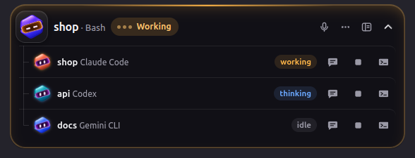

[The pill](#-the-pill) ·
[Approvals](#-approvals-without-alt-tab) ·
[New task](#-start-anything-new-task) ·
[Workspace](#-the-workspace) ·
[Agentic workflows](#-agentic-workflows) ·
[Builder](#-workflow-builder) ·
[Safety](#-safety-nets) ·
[Keys](#-keyboard) ·
[Install](#-getting-started)

</div>

> All screenshots show **made-up demo projects** (`shop`, `api`, `blog`, `docs` in `/home/demo/projects`).
> Nothing here comes from a real machine.

---

## 💡 Why

You started three agents in three terminals. One waits for permission to run `npm install`. One
finished ten minutes ago. One is quietly rewriting your auth layer. You find out whenever you happen to
alt-tab.

Bayloob closes that gap. Its pill sits at the top centre of the screen, and its mascot shows what the
agents are doing at a glance. When an agent needs you, the pill opens. When none does, it stays out of the
way, and clicks go straight through it to the window underneath.

When one agent isn't enough, Bayloob runs **workflows**: a planner, several builders racing each other in
their own git worktrees, the project's own tests, and a reviewer. You approve the plan, pick the winner and
merge it. Nothing is merged, pushed or deleted without your click.

<table>
<tr>
<td width="33%" valign="top"><b>👀 See</b><br>Every agent's state in one pill: thinking, working, needs you, done. The manager mascot always shows the most urgent one.</td>
<td width="33%" valign="top"><b>✋ Decide</b><br>Allow, deny or answer from a card. Rules learn your habits, and a red card warns when something looks like what you denied before.</td>
<td width="33%" valign="top"><b>🚀 Run</b><br>Start one agent, or a Pipeline / Best-of-N team. Live board, side-by-side candidates, a gate wherever you should decide.</td>
</tr>
</table>

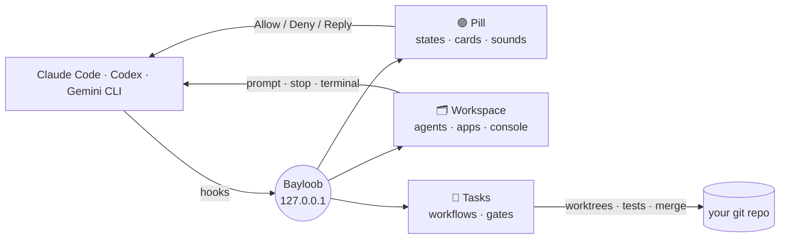

---

## 🟣 The pill

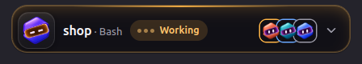

The big mascot is **Bayloob itself, the manager**. Your agents are its **subs**, stacked next to it in
their own colours. Hover or click to open the list. Each agent gets one row with **💬 send a prompt**,
**⏹ stop** and **▸_ open terminal**.

| Who | Colour |
|---|---|
| Bayloob (manager) | violet |
| Claude Code | coral |
| Codex | teal |
| Gemini CLI | blue |
| anything else | silver |

The mascot acts out every state. It **blinks** when idle, **reads** while thinking, **chomps** while
working, **knocks** with a `!` when it needs you, and does a **happy jump** when done. It falls asleep after
five quiet minutes and **dances** to music from any MPRIS player (Spotify, a browser tab, VLC…). Calm states
never animate forever, so the pill costs about 3 % CPU when nothing happens.

<table>
<tr>
<td valign="top" width="50%"><b>Pick a size</b><br><sub>Settings → Pill size: S · M · L</sub><br>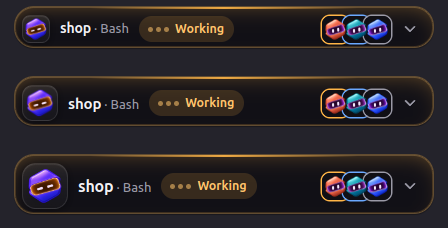</td>
<td valign="top" width="50%"><b>⋯ More</b><br><sub>Mute sounds and full view, by name. A muted pill keeps a red sound icon so you don't forget.</sub><br>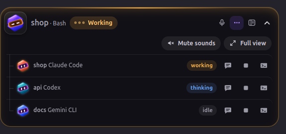</td>
</tr>
</table>

Other things the pill does:
- **🎙 Voice prompt**: speak, it's transcribed on your machine, you confirm, it's sent.
- **Full view**: the pill grows into a roomy panel.
- **📋 To-do progress**: a thin bar shows how far the top agent is through its own to-do list (*2 of 5*).

---

## ✋ Approvals without alt-tab

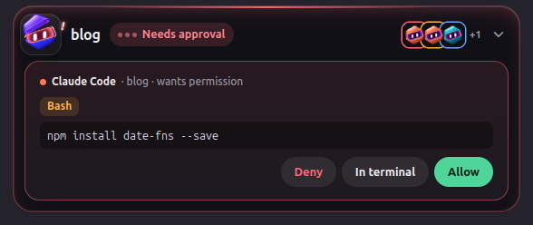

When Claude Code asks for permission, a card shows the tool and the **exact** command:

| Button | What happens |
|---|---|
| **Allow** | The agent runs it |
| **Deny** | The agent skips it and is told *"User denied this from Bayloob"* |
| **In terminal** | The question goes back to the agent's own terminal prompt |

**Nothing hides behind a click.** If a command is too long to show in full, the card says how much is
missing and **Allow** is disabled. You can then approve it only in the terminal, where you can read all of it.
Questions (`AskUserQuestion`) become buttons. Menus an agent shows only in its terminal, like folder trust
or update offers, become cards too. Each option is its own button, never a bare Enter.

### 🛡 An immune system for permissions

| | What happens |
|---|---|
| **Combo** | You allowed the same simple command three times in a project (`npm test`)? The card offers **Always allow here**. After that it passes without a card, and the pill shows *✓ allowed by rule*. Never offered for pipes, `;`, `&&`, `$( )`, redirects, `sudo`, `rm -r`, `--force` or paths outside the project |
| **Antibody** | Something that looks like a command you denied (`git push -f` after `git push --force`) gets a red card, and **Deny** becomes the main button |
| **Tripwire** | Three approvals in a second? The next **Allow** waits 3 s (🔒). Read it first |
| **Waiting meter** | Cards show *waiting 1m 14s*, a soft reminder plays after a minute, and the workspace counts how long agents waited today |

No answer within 280 s? The decision goes back to the terminal. If Bayloob isn't running, the hook exits
immediately. **Bayloob never blocks your agent.**

### ✅ Know the moment work is done

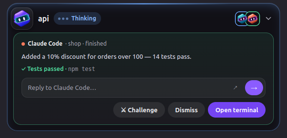

A finished card shows the agent's last answer and a **delivery receipt** read from its own turn:
**✓ Tests passed**, **✗ Tests failed** or **⚠ Code changed, no tests run**. **Reply** right in the card
(typed into tmux, no terminal needed), ask it to run the tests, **⚔ Challenge** it, or open its terminal.
The right window, and even the right tmux pane, comes forward.

---

## 🚀 Start anything: New task

Pill → **New task**, `Ctrl+K` → *New task…*, the tray, or `Ctrl+Alt+Space`. Four steps:
**① Project · ② Category · ③ Configure · ④ Confirm.** Your draft is saved at every step, so close the
dialog whenever you like.

<table>
<tr>
<td valign="top" width="50%">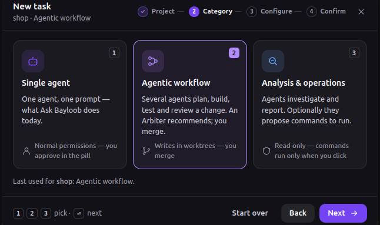</td>
<td valign="top" width="50%">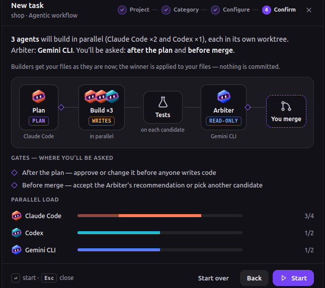</td>
</tr>
</table>

| Category | What it does | Safety |
|---|---|---|
| **Single agent** | Claude Code, Codex or Gemini CLI gets your prompt. Optionally in a **new git worktree**, and in the terminal you pick. Files: 📎, drop or paste a screenshot | Normal permissions, from the pill |
| **Agentic workflow** | **Pipeline** or **Best-of-N** (or your own template). Planner, builders, reviewer, how many of each | Builders write only in their own worktrees. You merge |
| **Analysis & operations** | Code audit, security review, incident / log analysis, performance, dependencies, with an optional runbook | Read-only. Commands only run when you click |

The confirm step says it in plain words: *"3 agents will build in parallel (Claude Code ×2 and Codex ×1),
each in its own worktree. You'll be asked after the plan and before merge."* It also shows the stages, the
gates and how much of each agent's capacity the task will use.

---

## 🗂 The workspace

Click the pill and the **workspace** drops down. That's the quick look. Press **↗** and it opens as a
**window of its own**: resizable, it remembers where you left it, has splitters between the columns
(double-click to reset), a sidebar that collapses to icons with `Ctrl+B`, and stays open.

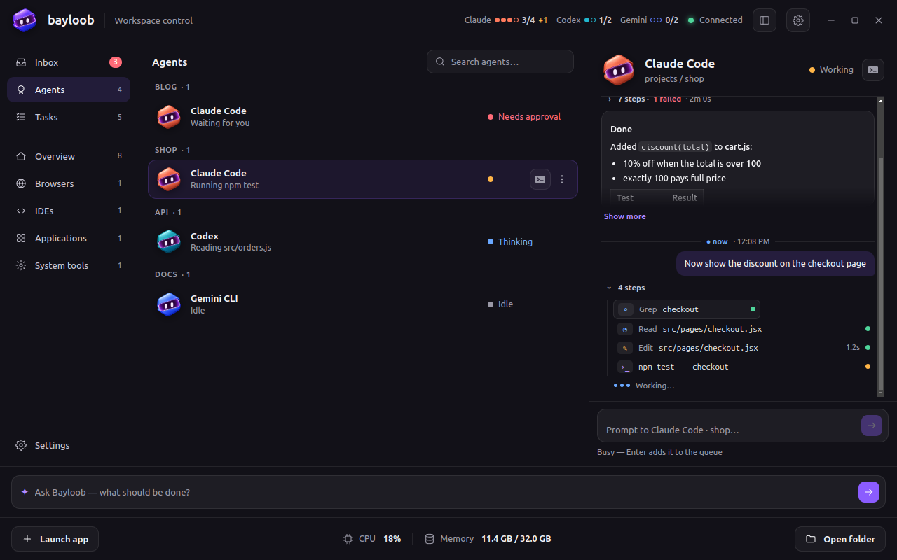

| Section | What you get |
|---|---|
| **Inbox** | Everything that waits on you: permissions, questions, terminal menus, task gates, finished turns |
| **Agents** | Grouped by project, each row says what the agent is doing right now |
| **Tasks** | The task board, task details and workflow templates (see below) |
| **Overview** | Your running apps and agents, grouped |
| **Browsers · IDEs · Applications** | Windows (click to focus), tabs, memory, CPU, recent activity. **Launch app** searches everything installed |
| **System tools** | Docker containers with health: logs, start, stop, restart (stop and restart ask first) |

### The agent console

Pick an agent and the right column shows its turns, read from its own transcript:
- **Your prompt.**
- **Its steps**, folded behind *"7 steps · 1 failed · 2m 0s"*. The newest turn stays open, a long one shows
  its last 8, and a click opens the whole command.
- **Its answer, as Markdown**: lists, tables, code.

Below it is the **prompt box**:
- **Enter** sends; a busy agent gets it **queued** for the end of its turn.
- **`/` shortcuts**: `/test`, `/review`, `/explain`, `/continue`.
- **History** with ↑.
- **📎 files**, dropped files and pasted screenshots.
- A confirm step before anything goes.

<table>
<tr>
<td valign="top" width="50%">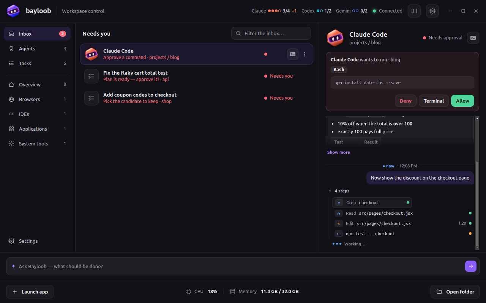</td>
<td valign="top" width="50%">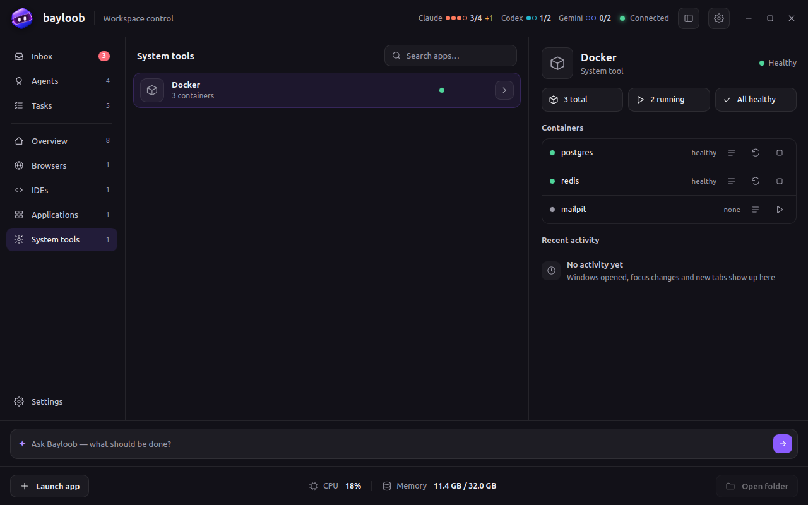</td>
</tr>
</table>

`Ctrl+K` opens a palette for everything: go to a section, jump to an agent, New task, open the task
board, launch an app, open an agent's terminal or folder, Settings.

<details>
<summary><b>🌗 Light theme</b> — every window comes in light and dark, following GNOME (or your choice)</summary>
<br>
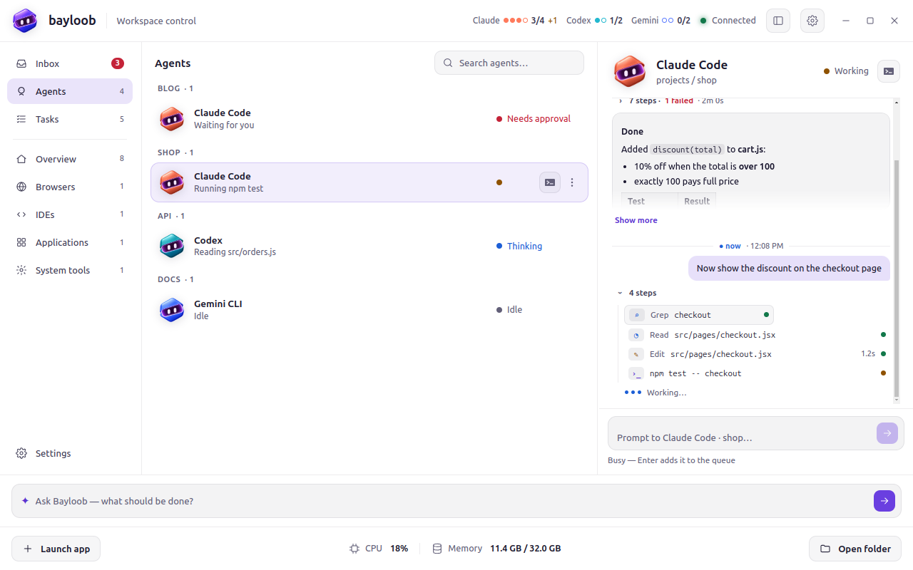
</details>

---

## 🧩 Agentic workflows

One task, a team of agents, and you decide at the gates. Bayloob runs the agents' own CLIs and makes **no
LLM calls itself**.

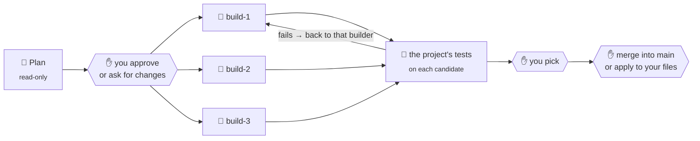

| Pattern | Shape |
|---|---|
| **Pipeline** | Plan → Build → Tests → Review (a different agent, read-only) → you pick → you merge |
| **Best-of-N** | Plan → N builders in parallel, mixing agents (Claude ×2 + Codex ×1) → tests on each → you pick the best → you merge |

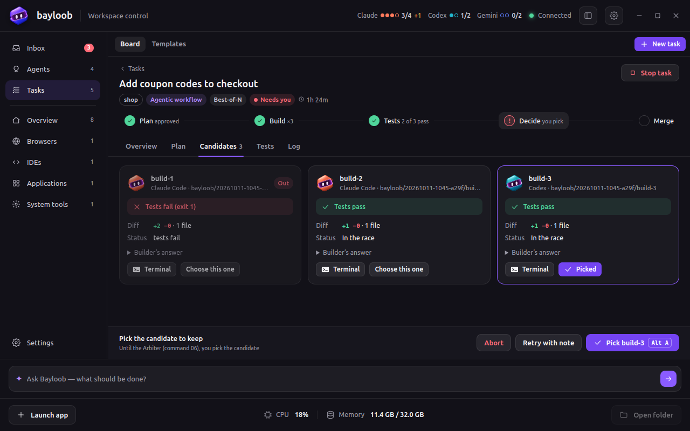

**How a task runs:**
- **Worktrees:** every builder gets its own worktree and branch, `bayloob/<task>/build-<n>`. Your checkout
  is never touched.
- **Read-only agents:** planners and reviewers share one read-only worktree.
- **Start from your files:** if the project has uncommitted work, choose **"Your files now"** (the default
  then). Builders start from exactly what's on your disk, and the winner is applied back to your files
  without a commit. Otherwise choose **"The last commit"**, and the winner is merged into your branch.
- **Failing tests:** a candidate whose tests fail is sent back to **its own session** with the test output,
  so it keeps its context. After the loop limit it drops out of the race.
- **Board:** Queued · Running · Needs you · Review · Done · Failed. Each card shows its stage, agents,
  elapsed time and diff.
- **Task detail:**
  - a stage stepper;
  - tabs: **Overview** (every agent, with *Terminal*), **Plan**, **Candidates**, **Tests**, **Log** (the
    audit trail: who did what, when);
  - one decision bar at the bottom right (`Alt+A` takes the main action).

<table>
<tr>
<td valign="top" width="50%">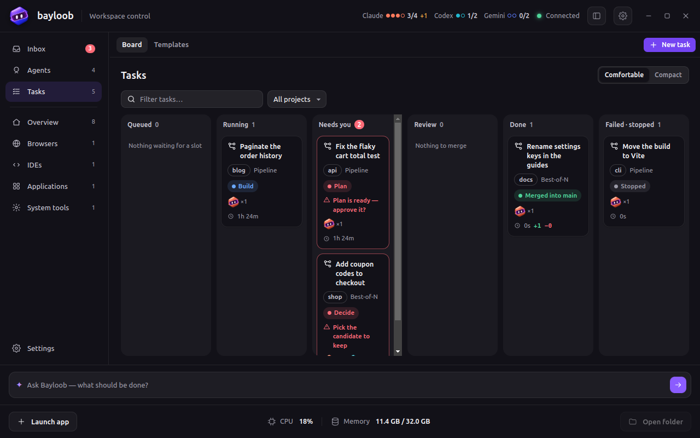</td>
<td valign="top" width="50%">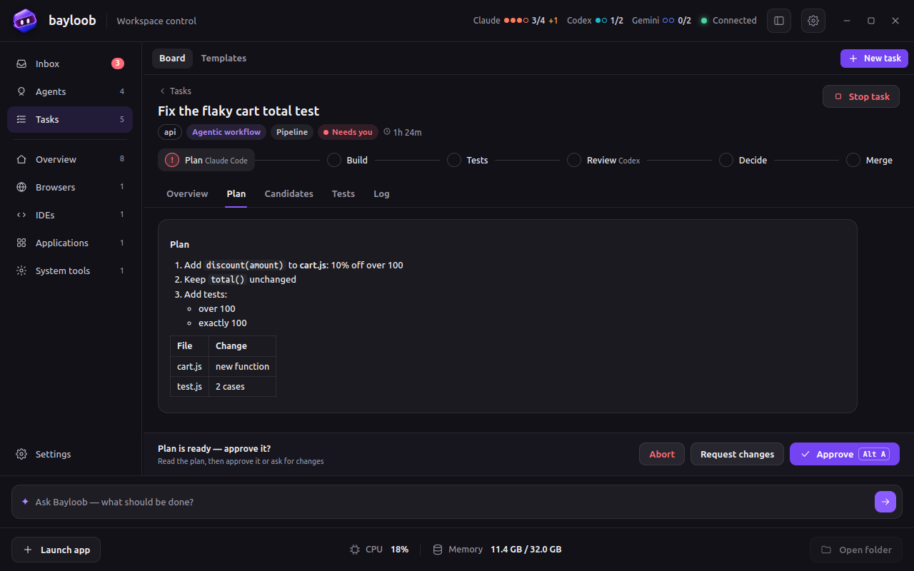</td>
</tr>
</table>

### ✋ Where you're asked

| Gate | You can |
|---|---|
| **Plan ready** | Approve · Request changes (your note goes to the same agent) · Abort |
| **Pick the candidate** | Pick one · Retry with a note · Abort |
| **Merge** | Merge into your branch (only on a clean tree; a conflict is undone and listed) · or **Apply to my files** · Keep the branch · Abort |
| **No candidate passes** | Continue anyway · Retry with a note · Abort |
| **A session ended mid-turn** | Run again · Abort |
| **A read-only agent changed files** | Continue · Abort |

A gate reaches you like a permission would: a card in the pill, a row in the Inbox, and the same sound.

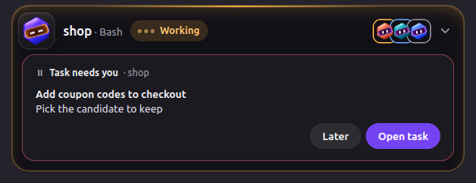

### 🔒 Read-only means read-only, three times over

Planners and reviewers run with:
1. **The CLI's own mode.** Claude Code runs in `dontAsk` with only `git diff/log/show/status/ls-files`,
   `ls`, `grep`, `rg` and `wc` allowed. Codex runs with `--sandbox read-only`.
2. **Bayloob's hook,** which refuses any non-read-only request for those roles.
3. **A `git status` check after every turn.** A changed tree stops the task at a gate.

### 🎚 Capacity

Settings → Agents sets how many instances of each agent may run at once (Claude Code 4, Codex 2,
Gemini CLI 2), plus limits for all agents together and per project. Launches are held when free memory is
low. Extra instances **queue** instead of failing, and the card tells you why
(*"claude 4/4 running"*). A rate-limited agent backs off (1, 2, 4 … 30 min) and is never retried in a loop.
The workspace header shows live usage: `Claude ●●●○ 3/4 +1`.

---

## 🛠 Workflow builder

Tasks → **Templates**. Pipeline and Best-of-N are built in and read-only. **Duplicate** one and make it
yours, or open **Customize stages…** right from the New task dialog.

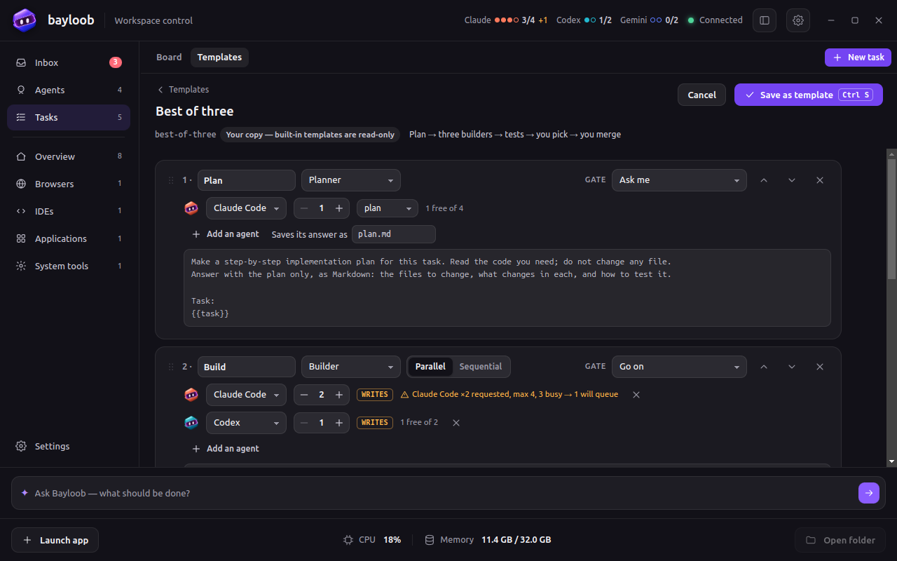

Each stage has:
- a title, a role and a gate;
- **parallel / sequential**;
- agent slots, each with a count stepper and its mode (*writes* / *read-only* / *plan*);
- a prompt editor where `{{` completes the values: `{{task}}`, `{{base}}`, `{{branch}}`,
  `{{candidate}}`, `{{note}}`, `{{artifact:plan.md}}` and earlier stages' answers;
- **on fail → go back to an earlier stage**, with a loop limit.

Move stages with `Alt+↑/↓`. Problems show **under the stage they belong to** as you type, and `Ctrl+S`
saves only a template without problems. Your templates live in `~/.config/Bayloob/workflows/` and show up
as choices in New task.

<details>
<summary><b>Templates list</b></summary>
<br>
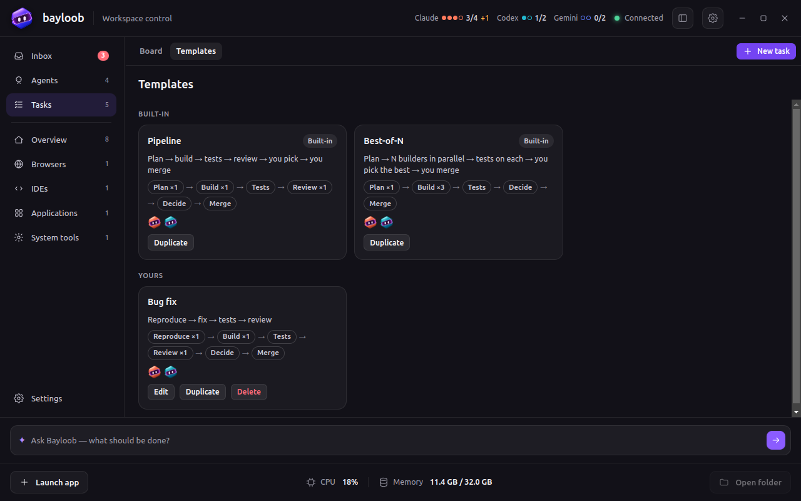
</details>

---

## 🧯 Safety nets

| | |
|---|---|
| **⚔ Challenge** | A *different* agent (Codex for Claude's work, and the other way round) starts read-only and tries to break the change. Its findings are clickable `file:line` links that open in your editor |
| **⚠ Collision radar** | Two agents edit the same file in the same repo? A red ⚠ and a notification. Same tree, different files? A yellow one. **Move new work to a worktree…** starts the next agent on its own branch |
| **🐞 Copy an error, fix it** | With *Watch clipboard* on, a copied stack trace (Python, JS/TS, PHP, Go, Java) makes the pill ask *Fix it?*. Nothing is sent without you |
| **📬 Delivery receipts** | A turn that changed code is green only if its tests passed |
| **🔐 Local only** | The server listens on `127.0.0.1`, refuses browser origins and foreign `Host` headers, and every request carries a secret only you can read |

---

## ⚙️ Settings

<table>
<tr>
<td valign="top" width="50%">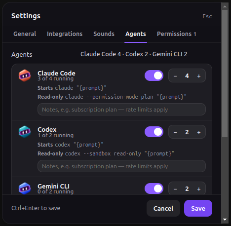</td>
<td valign="top" width="50%">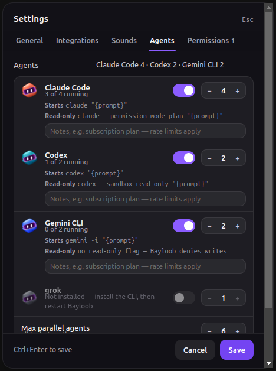</td>
</tr>
</table>

| Tab | What's in it |
|---|---|
| **General** | Mascot (Novi 3D / Classic) · Pill size S / M / L · Theme System / Light / Dark · Launcher shortcut · Dance to music |
| **Integrations** | Claude Code hooks and the GNOME extension (install from here) · Terminal · Editor · Agents in tmux · Watch clipboard |
| **Sounds** | Volume, a sample, and each sound on or off |
| **Agents** | Per agent: on/off, max parallel instances, the exact commands Bayloob runs, a note. Limits for all agents, per project and free memory |
| **Permissions** | Your *always allowed* rules and remembered denials. Each one can be removed |

Changes apply at once, with no restart. Everything is saved in `~/.config/Bayloob/settings.json`.

---

## ⌨️ Keyboard

| Where | Keys |
|---|---|
| Anywhere | <kbd>Ctrl</kbd>+<kbd>Alt</kbd>+<kbd>Space</kbd> New task / launcher (configurable) |
| Workspace | <kbd>Ctrl</kbd>+<kbd>K</kbd> palette · <kbd>↑</kbd> <kbd>↓</kbd> pick · <kbd>Enter</kbd> main action · <kbd>Ctrl</kbd>+<kbd>B</kbd> collapse the sidebar (window) · <kbd>Esc</kbd> close (popup) |
| Prompt box | <kbd>Enter</kbd> send · <kbd>Shift</kbd>+<kbd>Enter</kbd> new line · <kbd>/</kbd> shortcuts · <kbd>↑</kbd> history |
| New task | <kbd>1</kbd> <kbd>2</kbd> <kbd>3</kbd> category · <kbd>Enter</kbd> next / start · <kbd>Alt</kbd>+<kbd>←</kbd> back |
| Tasks | <kbd>/</kbd> filter · <kbd>[</kbd> <kbd>]</kbd> tabs · <kbd>Alt</kbd>+<kbd>A</kbd> the decision's main action · <kbd>Ctrl</kbd>+<kbd>Enter</kbd> send a note · <kbd>Esc</kbd> back to the board |
| Builder | <kbd>{{</kbd> values · <kbd>Alt</kbd>+<kbd>↑</kbd>/<kbd>↓</kbd> move a stage · <kbd>Ctrl</kbd>+<kbd>S</kbd> save |
| Settings | <kbd>←</kbd> <kbd>→</kbd> tabs · <kbd>Ctrl</kbd>+<kbd>Enter</kbd> save · <kbd>Esc</kbd> close |

---

## 📦 Getting started

Bayloob is built for **Linux** (tested on Ubuntu with GNOME). Launching agents needs **tmux**
(`sudo apt install tmux`), and building it needs [Bun](https://bun.sh).

```bash
git clone https://github.com/bayramlibahram/bayloob && cd bayloob
bun install
bun run dist:deb                     # → dist/bayloob_<version>_amd64.deb
sudo apt install ./dist/bayloob_*_amd64.deb

bayloob --install-hooks              # adds Bayloob's hooks to ~/.claude/settings.json (backs it up first)
bayloob &                            # or start "Bayloob" from your app menu
```

| Command | What it does |
|---|---|
| `bayloob` | Starts the pill |
| `bayloob --install-hooks` | Installs the Claude Code hooks and prints the lines for Codex and Gemini CLI |
| `bayloob --new-session` | Opens New task (starts Bayloob first if needed). A good system shortcut on Wayland |
| `bayloob --panel` | Opens the workspace |
| `bayloob --install-extension` | Installs the GNOME Shell extension for window focus on Wayland |
| `bayloob --autostart` / `--no-autostart` | Start (or stop starting) Bayloob at login |
| `bayloob --demo` | A ~70 s scripted tour on demo projects, next to your running Bayloob |

<details>
<summary><b>Codex & Gemini CLI</b></summary>
<br>

```toml
# ~/.codex/config.toml — `bayloob --install-hooks` prints the exact path for your machine
notify = ["/opt/Bayloob/resources/hooks/bayloob-hook", "codex"]
```

Interactive Codex (0.162) no longer calls `notify` at the end of a turn, so Bayloob also reads Codex's own
session log (its *rollout*) to see turns start and end. The line above still matters for `codex exec`.
For Gemini CLI, add the same command with `gemini` to the `hooks` section of `~/.gemini/settings.json`.
</details>

<details>
<summary><b>Wayland notes</b></summary>
<br>

- **Window focus:** Wayland doesn't let one app raise another's windows. Bayloob's small GNOME Shell
  extension does it from inside the shell. Enable it once in Settings → Integrations, then log out and in.
- **Global shortcuts:** these only fire while an X11 window has focus on Wayland. Bind a system shortcut to
  `bayloob --new-session` instead.
- **The pill:** it runs under XWayland, so it can stay on top and in place. Its window shape matches the
  pill, so clicks around it go through.
</details>

<details>
<summary><b>Environment variables</b></summary>
<br>

| Variable | Default | What it does |
|---|---|---|
| `BAYLOOB_PORT` | `7777` | Local port for the server and the hooks |
| `BAYLOOB_TOKEN_FILE` | `~/.config/Bayloob/token` | The shared secret of the app and the hooks |
| `BAYLOOB_PERM_TIMEOUT` | `280` | Seconds before a permission goes back to the terminal |
| `BAYLOOB_SHORTCUT` | `Ctrl+Alt+Space` | Global shortcut (empty turns it off) |
| `BAYLOOB_TERMINAL` | auto-detected | Terminal for launched sessions, e.g. `kitty` |
| `BAYLOOB_EDITOR` | file manager | Command for *Open folder*, e.g. `code` |
| `BAYLOOB_THEME` | `system` | `light` or `dark` |
| `BAYLOOB_MASCOT` | `novi` | `svg` for the original flat mascot |
| `BAYLOOB_SOUNDS` / `BAYLOOB_NO_MUSIC` | on | `0` / `1` to turn them off |

A variable, when set, wins over the saved setting, and that setting is shown read-only.
</details>

---

## 🧠 How it works

```
Claude Code hook ─┐                                  ┌─► Pill            (states, cards, sounds)
Codex notify ─────┼─► bayloob-hook ─HTTP─► EventServer ─► SessionStore ─┼─► Workspace       (popup / window)
Gemini CLI hook ──┘   (pure bash)    ◄─ decision ─┘                      └─► Tasks           (board, detail, builder)
Codex rollouts ── AgentDiscovery (/proc) ─────────────┘

New task ─► TaskEngine ─► Scheduler (capacity) ─► TaskRunner (tmux, in the background) ─► agent CLIs
               │                                └─► TaskWorkspace (git worktrees, tests, merge / apply)
               └─► tasks/<id>/state.json · log.jsonl · artifacts/        (survives a restart)
```

- **The hook** is a dependency-free bash script that talks to `127.0.0.1` over `/dev/tcp`. An event costs
  about 10 ms.
- **The engine** saves its state after every change. A restart picks up where it was, and a session that's
  gone becomes a gate instead of silently failing.

The code is split by Electron process, then by layer: `src/main` (app, modules, infrastructure, windows),
`src/preload`, `src/renderer` (one page per window) and `src/shared` (used by both sides). See
[docs/architecture.md](docs/architecture.md), and for the engine [docs/orchestration/ENGINE.md](docs/orchestration/ENGINE.md).

## 🧪 Development

```bash
bun install
bun run dev              # from source
bun run test             # unit tests (node --test)
bun run check            # Biome: lint + format (check:fix applies)
bun run demo             # the scripted tour
node scripts/task-demo.js  # Pipeline and Best-of-N end to end on a toy repo, with stub agents
```

## 🗺 Next up

**Arbiter**: a decision agent that ranks the candidates and recommends one, and you still decide ·
**Split work** and **Review board** patterns · **Analysis** (read-only reports with evidence) ·
**Operations** runbooks, run step by step · agent **discussions** · UI scale and accessibility polish.

<div align="center">
<br>

<br>
<sub>MIT © 2026 Bahram Bayramli · Made with 💜 by <a href="https://baynovix.com">Baynovix</a></sub>
</div>
