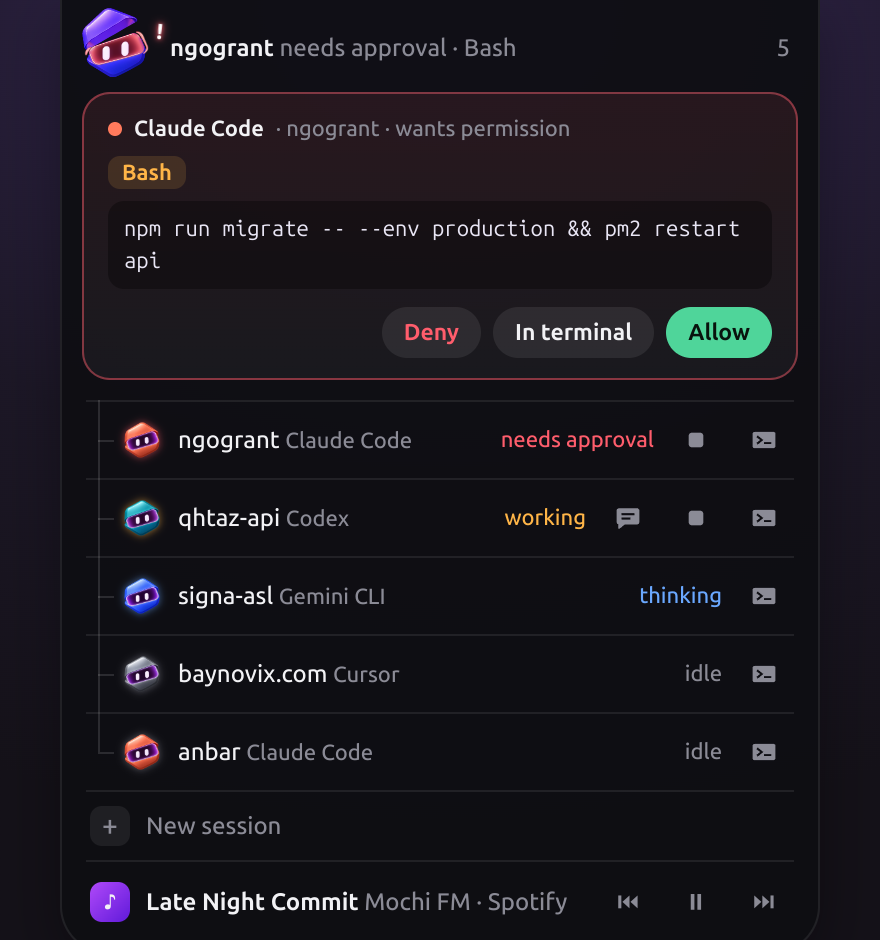
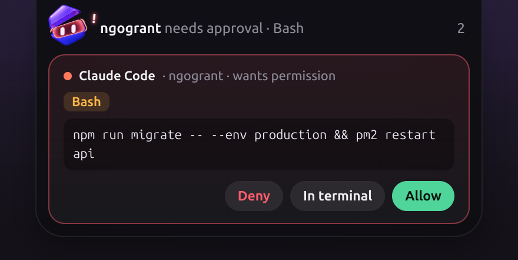
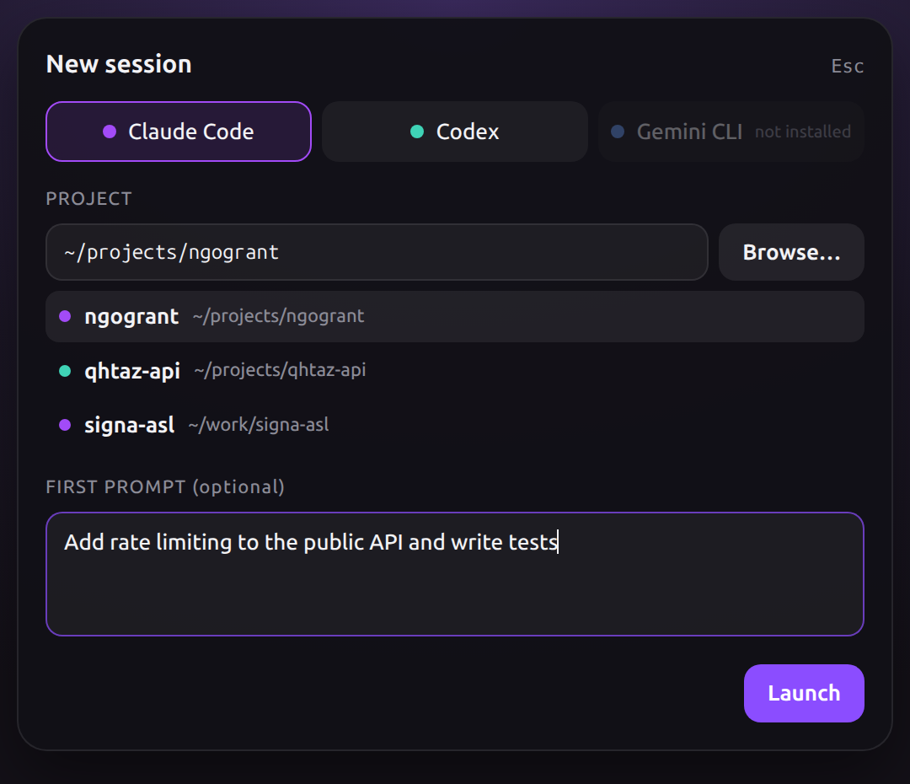
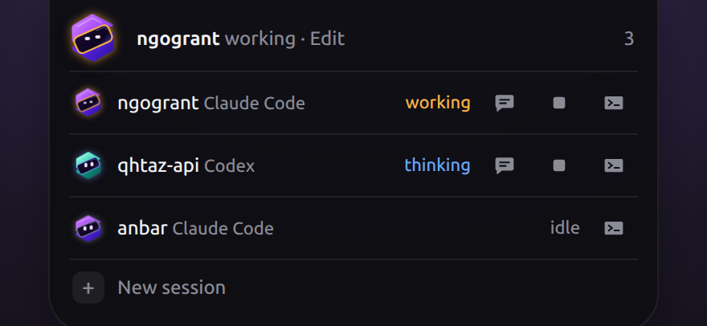
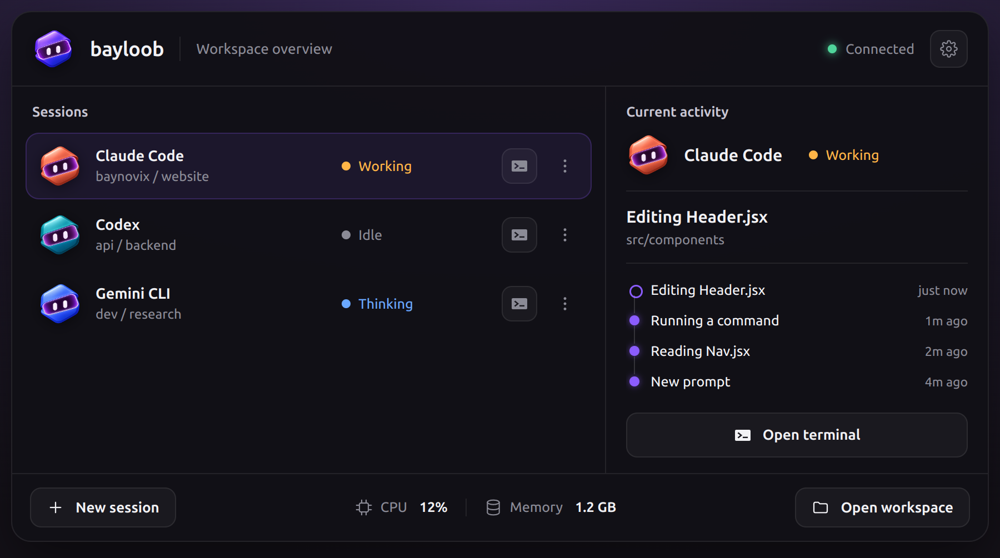
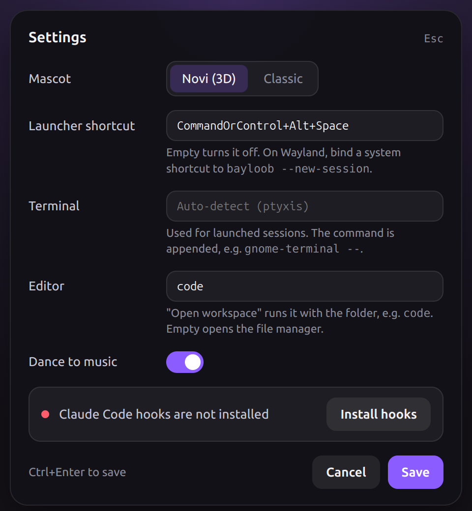
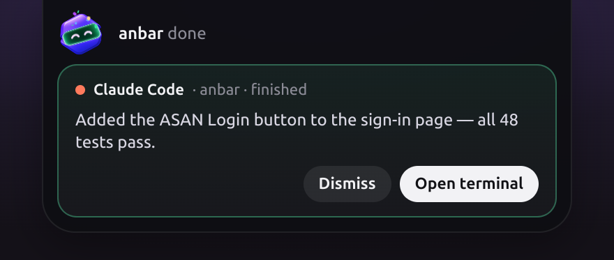

<div align="center">


# Bayloob

**Your AI agents, in the loop. You, in control.**

A tiny mascot that lives at the top of your screen and keeps an eye on every
Claude Code, Codex and Gemini CLI session — so you don't have to.

`no cloud` · `no API keys` · `no telemetry` · `127.0.0.1 only`



</div>

---

## Why?

You kicked off three agents in three terminals. One is waiting for permission to run
`npm install`. One finished ten minutes ago. One is quietly rewriting your auth layer.
You find out about all of this… whenever you happen to alt-tab.

Bayloob fixes that. It sits in a small pill at the top-center of your screen, and its
mascot shows you what your agents are doing at a glance: thinking, working, waiting on
you, or done. When an agent needs you, the pill opens up. When it doesn't, the pill stays
out of your way, and clicks go straight through to the window underneath.

## What it does

### ✋ Approve or deny without leaving what you're doing



When Claude Code asks for permission, a card shows the tool and the exact command.
Three choices:

| Button | What happens |
|---|---|
| **Allow** | The agent runs it |
| **Deny** | The agent skips it and is told *"User denied this from Bayloob"* |
| **In terminal** | The question goes back to the normal terminal prompt |

**Nothing hides behind a click.** If a command is too long to show in full, the card says how
many characters are missing and **Allow** is disabled, so you can only approve it in the terminal
where you can read all of it.

No answer in 280 seconds? The decision goes back to the terminal automatically
(`BAYLOOB_PERM_TIMEOUT`). If Bayloob isn't running at all, the hook exits instantly and your
agent behaves exactly as it always has. **Bayloob never blocks your agent.**

### 🚀 Launch and steer agents from the pill



Start a new agent without opening a terminal first. Pick **Claude Code**, **Codex** or **Gemini CLI**,
choose a project (recent ones are one click away), optionally type a first prompt, and hit
**Ctrl+Enter**. The agent starts in its own **tmux** session and opens in your terminal, so it keeps
running even if you close the window.



Every session that runs in tmux gets extra buttons in the list:

| Button | What it does |
|---|---|
| 💬 **Send a prompt** | Type a follow-up and it lands in the agent's input, no window switching |
| ⏹ **Stop** | Ends a session Bayloob launched (click twice to confirm) |
| ▸_ **Open terminal** | Raises its window, or reopens one attached to tmux if you closed it |

Three ways to open the launcher:

- the **+ New session** row at the bottom of the session list
- the global shortcut **Ctrl+Alt+Space** (`BAYLOOB_SHORTCUT` to change it, empty to turn it off)
- the **tray icon**, which also relaunches recent projects in one click

> **On Wayland**, global shortcuts only fire while an X11 window has focus. Bind a system shortcut
> (GNOME Settings → Keyboard → Custom Shortcuts) to `bayloob --new-session` instead. It opens the
> launcher in the running Bayloob.

### 🗂️ The whole workspace at a glance



Click the pill and the **workspace overview** drops down from the top of the screen:

- **Sessions:** every agent with its project, status, an open-terminal button and a **⋮** menu
  (open terminal, send a prompt, open workspace, stop, hide from list)
- **Current activity:** what the selected agent is doing right now (*Editing Header.jsx ·
  src/components*), plus a timeline of its last steps, built from the hook events
- **CPU and memory** of all watched agents and every process they started (tests, builds, servers)
- **Connected:** whether the Claude Code hooks are installed and when the last event arrived
- **New session** and **Open workspace** (your editor, or the file manager)

Use ↑ ↓ to pick a session, Enter to open its terminal, Esc to close. `bayloob --panel` opens the
panel from anywhere, which makes a handy system shortcut on Wayland.

### ⚙️ Settings



The gear in the panel opens the settings: mascot style, launcher shortcut, terminal, editor and
music. Changes apply right away, with no restart. If the Claude Code hooks are missing, you can
install them from here. Settings are saved in `~/.config/Bayloob/settings.json`.

### ✅ Know the moment work is done



A "finished" card shows a short summary of the agent's last reply. Hit **Open terminal**
and Bayloob brings the right window to the front, even the right tmux pane.

| Terminal | How it's focused |
|---|---|
| kitty | `kitty @ focus-window` (needs `allow_remote_control yes`) |
| WezTerm | `wezterm cli activate-pane` |
| tmux | selects the pane, then raises the terminal hosting it |
| Any X11 / XWayland window (xterm, VS Code, Cursor, Tilix, Konsole…) | `_NET_ACTIVE_WINDOW` via python3 + libX11 |
| GNOME Terminal / Ptyxis on native Wayland | ✗ Wayland doesn't let other apps raise windows |

### 🎨 One manager, many agents

The big mascot in the pill is **Bayloob itself, the manager**. It's always violet and always shows
the most urgent thing across all your sessions: if any agent needs approval, the manager's lid pops
open. Your agents are its **subs**. They're listed under it, each in its own color, so you can tell
them apart from across the room:

| Who | Color |
|---|---|
| Bayloob (manager) | Baynovix violet |
| Claude Code | Coral |
| Codex | Teal |
| Gemini CLI | Blue |
| Cursor, and anything else | Silver |

### 💃 It dances


Play something in Spotify, a browser tab or VLC while your agents are idle, and the
mascot starts to dance. The pill shows the song, and the session list gets ⏮ ⏯ ⏭ controls.
Works with any MPRIS player over `gdbus`. Not in the mood? `BAYLOOB_NO_MUSIC=1 bayloob`.

## The mascot

The mascot is a layered 3D-style character (body, lid, visor and eyes) animated by
[`src/novi.js`](src/novi.js), a small engine with no dependencies. Every state has its own little story:

| What the agent did | State | What the mascot does |
|---|---|---|
| `SessionStart`, idle `Notification` | idle | blinks, glances around, breathes now and then. After 5 minutes it falls asleep (`z`) |
| `UserPromptSubmit`, `PostToolUse` | thinking · blue visor | eyes "read" left and right, it floats |
| `PreToolUse` | working · amber visor | the lid chomps, eyes focus |
| `PermissionRequest` | waiting · red visor | the lid pops open, a `!` appears, red ripples, an impatient knock |
| `Stop`, Codex `agent-turn-complete` | done · green visor | the lid flips, confetti, `^ ^` eyes and a happy jump |
| music playing, nothing to do | dance | sways to the beat, notes float off |
| `SessionEnd` | — | leaves the list |

In the pill the mascot is only 34 px, so it runs in **compact mode**: particles stay small and inside
the pill (the `!` appears beside it, not above). Calm states never run an endless animation, so the
overlay costs about 3% CPU when nothing is happening.

The session list shows a still image of each agent's mascot, so a long list stays cheap.

**Prefer the original flat mascot?** Run `BAYLOOB_MASCOT=svg bayloob`.

**Adding a color:** each pack in `src/packs/<color>/` holds 5 states × 4 layers (256×256 PNG) and a
`layers.json`. After adding or re-cutting one, run `bun scripts/build-pack-meta.js`.

## Getting started

Bayloob is built for **Linux** (tested on Ubuntu). macOS and Windows code paths exist
but are experimental. Launching agents needs **tmux** (`sudo apt install tmux`).

You'll need [Bun](https://bun.sh) to build it.

```bash
git clone <this repo> && cd bayloob
bun install
bun run dist:deb                               # → dist/bayloob_<version>_amd64.deb

sudo apt install ./dist/bayloob_*_amd64.deb
bayloob --install-hooks                        # adds hooks to ~/.claude/settings.json
bayloob &                                      # or launch "Bayloob" from your app menu
```

`--install-hooks` only **adds** entries. It backs up `settings.json` first, never removes
anything, and is safe to run again.

| Command | What it does |
|---|---|
| `bayloob` | Opens the overlay |
| `bayloob --install-hooks` | Installs Claude Code hooks and prints the lines for Codex and Gemini |
| `bayloob --new-session` | Opens the launcher (starts Bayloob first if it isn't running) |
| `bayloob --panel` | Opens the workspace panel (same) |
| `bayloob --autostart` / `--no-autostart` | Start (or stop starting) Bayloob when you log in |
| `sudo apt remove bayloob` | Uninstalls. Hooks stay in `settings.json` and do nothing while Bayloob is gone |

### Codex & Gemini

`--install-hooks` prints the exact lines for your machine. They look like this:

```toml
# ~/.codex/config.toml
notify = ["/opt/Bayloob/resources/scripts/bayloob-hook", "codex"]
```

For Gemini CLI, add the same command with `gemini` as the argument to the `hooks` section of
`~/.gemini/settings.json` (same format as Claude Code).

## How it works

```
Claude Code hook ──┐                                               ┌── focus.js  (raise the terminal)
Codex notify ──────┼─► bayloob-hook ──HTTP──► server.js ───────────┼── music.js  (MPRIS via gdbus)
Gemini CLI hook ───┘   (pure bash)   ◄─decision─                   └── IPC ──► index.html (mascot, cards)

launcher.html ──IPC──► session-launcher.js ──► tmux new-session ──► terminal.js (opens a window)
                                           ──► tmux send-keys / kill-session
```

The hook is a dependency-free bash script that talks to `127.0.0.1:7777` over `/dev/tcp`.
A normal event costs about 10 ms. Nothing leaves your machine, and the server only answers
local processes: requests from browser pages (an `Origin` header) or from a foreign `Host`
(DNS rebinding) are refused.

| File | Class | Role |
|---|---|---|
| `src/main.js` | `BayloobApp` | Entry point. Wires everything below to the windows over IPC |
| `src/session-launcher.js` | `SessionLauncher` | Starts agents in tmux; sends prompts, stops, reattaches |
| `src/terminal.js` | `TerminalLauncher` | Opens a command in whichever terminal emulator you have |
| `src/launcher-window.js` | `LauncherWindow` | The focusable popup for new sessions and prompts (`launcher.html`) |
| `src/recent-projects.js` | `RecentProjects` | Remembers where you launched agents |
| `src/tray.js` | `TrayMenu` | Tray icon: new session, relaunch recent, quit |
| `src/agents.js` | — | The agents Bayloob can launch and their command lines |
| `src/server.js` | `EventServer`, `SessionStore` | HTTP endpoint for hooks; sessions and the permission queue |
| `src/overlay-window.js` | `OverlayWindow` | The transparent, click-through, always-on-top window |
| `src/notifier.js` | `Notifier` | Desktop notifications for "needs approval" and "done" |
| `src/popup-window.js` | `PopupWindow` | Base for the focusable popups: launcher, panel, settings |
| `src/panel-window.js` | `PanelWindow` | The workspace overview (`panel.html`) |
| `src/settings-window.js` | `SettingsWindow` | The settings form (`settings.html`) |
| `src/settings.js` | `Settings` | Saved settings, with environment variables taking precedence |
| `src/activity.js` | — | Turns hook events into activity lines ("Editing Header.jsx") |
| `src/stats.js` | `AgentStats` | CPU and memory of agent process trees, from `/proc` |
| `src/ui-common.js` | `Agent` | Agent palette and helpers shared by the overlay and the panel |
| `src/focus.js` | `TerminalFocuser` | Raises the right terminal: kitty / WezTerm / tmux / X11 |
| `src/music.js` | `MusicWatcher` | What's playing over MPRIS, play / pause / next / prev |
| `src/cli.js` | — | `--install-hooks`, `--autostart`, `--no-autostart` |
| `src/index.html` | `OverlayView`, `NoviMascotView`, `SvgMascotView` | The pill: mascot, cards and session list |
| `src/novi.js` | `Novi` | Animation engine for the layered raster mascot |
| `src/packs/` | — | Mascot color packs (5 states × 4 layers each) and the generated `meta.js` |
| `scripts/build-pack-meta.js` | — | Bundles every pack's `layers.json` into `src/packs/meta.js` |
| `scripts/bayloob-hook` | — | The hook. Waits for your answer only on `PermissionRequest` |
| `scripts/hook.js` | — | Same hook in Node, for Windows (permission requests included) |
| `scripts/install-hooks.js` | `HookInstaller` | Safely merges hooks into `~/.claude/settings.json` |
| `scripts/x11-focus.py` | — | Activates an X11 window by PID or `WINDOWID` (ctypes, no deps) |
| `design/` | — | Mascot reference art and earlier mascot prototypes |

### Linux notes

- **Wayland:** Bayloob runs under XWayland (`--ozone-platform=x11`), because Wayland doesn't let
  apps position themselves or stay always-on-top.
- **Click-through:** the window's shape (`setShape`) matches the pill, so clicks around it land
  on whatever is underneath.
- **Ubuntu 24.04+:** the package installs an AppArmor profile (`/etc/apparmor.d/bayloob`) so
  Electron's sandbox can start.

## Configuration

Most of these are in the **Settings** window. An environment variable, when set, wins over the saved
setting (the field is then shown read-only), which is handy for development and scripts.

| Variable | Default | What it does |
|---|---|---|
| `BAYLOOB_PORT` | `7777` | Local port for the server and the hooks |
| `BAYLOOB_PERM_TIMEOUT` | `280` | Seconds before a permission request goes back to the terminal |
| `BAYLOOB_NO_MUSIC` | unset | Set to `1` to turn off music detection |
| `BAYLOOB_MASCOT` | `novi` | `svg` switches back to the original flat mascot |
| `BAYLOOB_SHORTCUT` | `Ctrl+Alt+Space` | Global shortcut for the launcher (Electron accelerator syntax); empty turns it off |
| `BAYLOOB_TERMINAL` | auto-detected | Terminal used for launched sessions, e.g. `kitty` or `gnome-terminal --` (the command is appended) |
| `BAYLOOB_EDITOR` | file manager | Command for "Open workspace", e.g. `code` (the folder is appended) |

## Development

```bash
bun install
bun run dev              # run from source (adds --no-sandbox, see below)
bun run test-events      # fake a full agent session, no real agent needed
bun run dist:deb         # build the .deb
```

Running from source on Ubuntu 24.04+, Electron's sandbox can't start without the AppArmor profile
the .deb installs, so `bun run dev` passes `--no-sandbox`. The packaged app keeps the sandbox on.

Opening `src/index.html` straight in a browser gives you a demo mode: drive it from the console
with `__demo.onSessions([...])`, `__demo.setMusic({...})` and `__demo.open()`.

## License

[MIT](LICENSE) © 2026 Bahram Bayramli · Made with 💜 by [Baynovix](https://baynovix.com)
